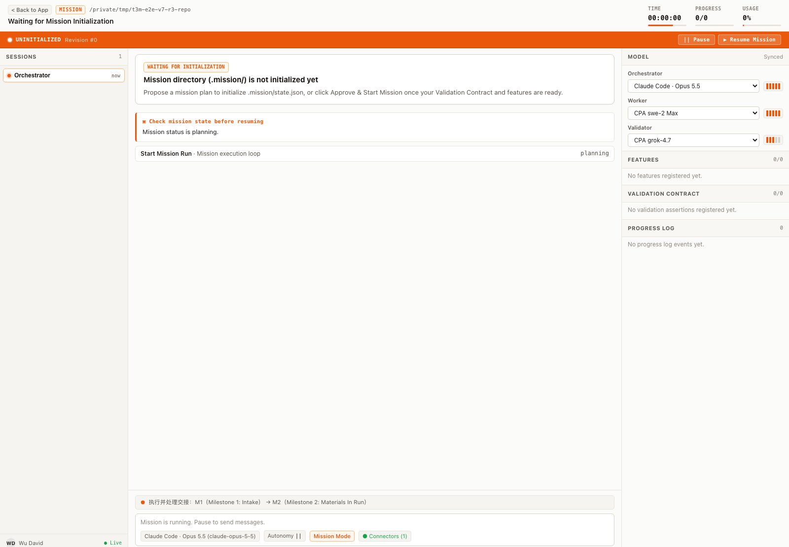
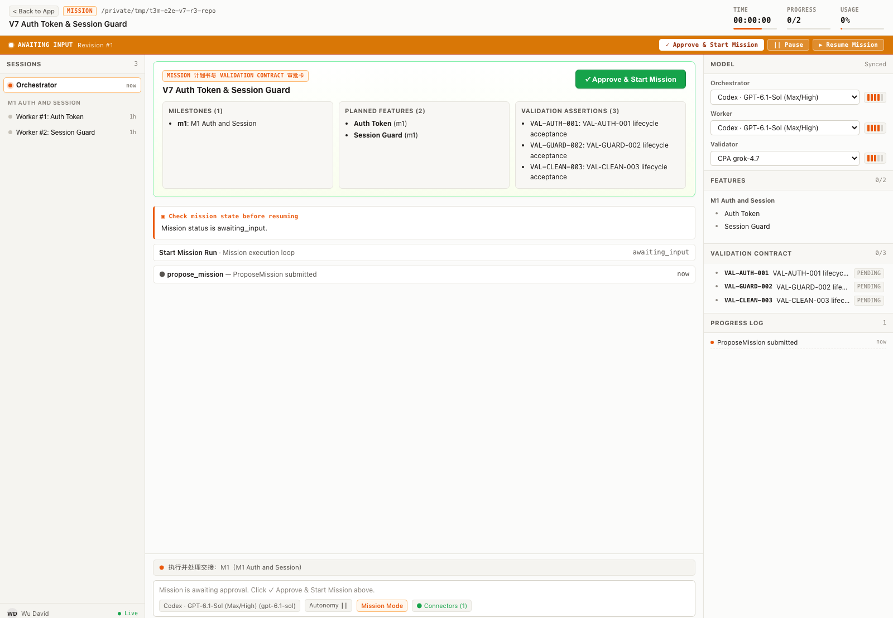
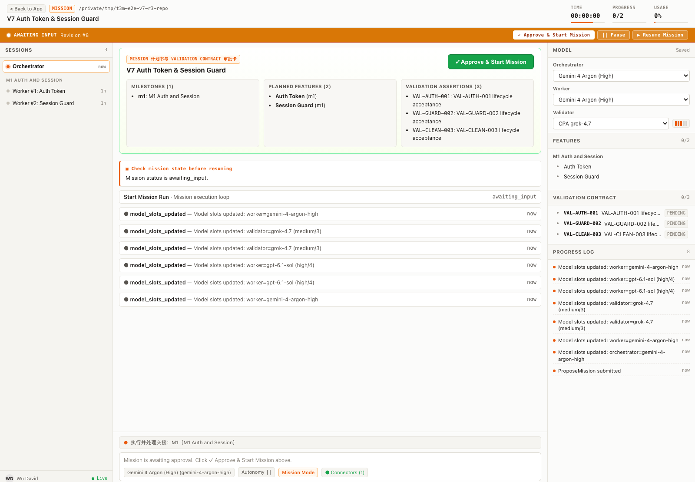
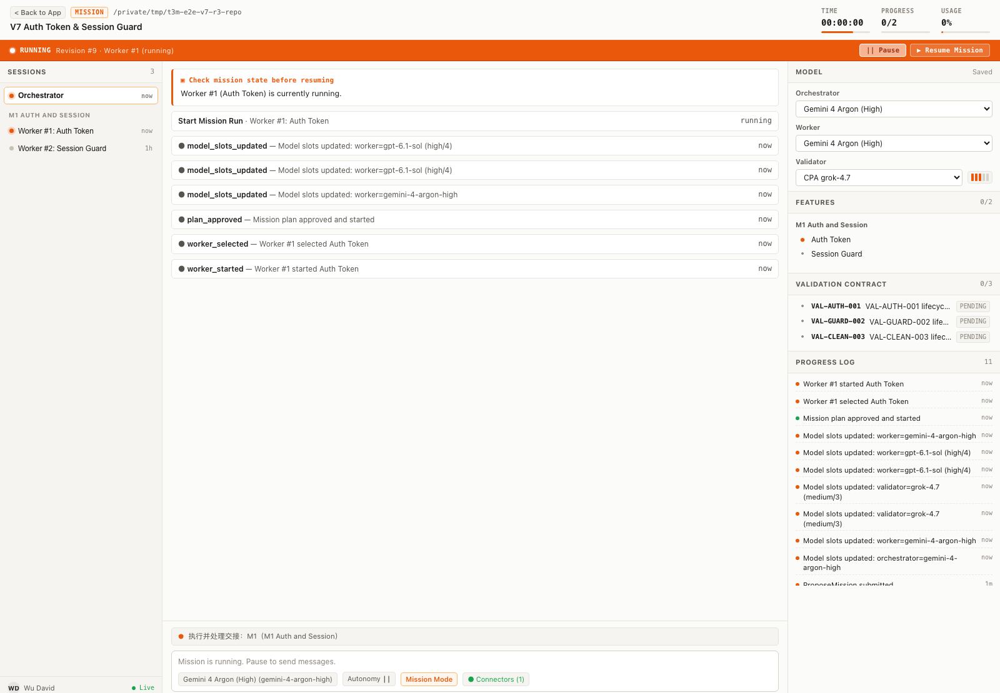
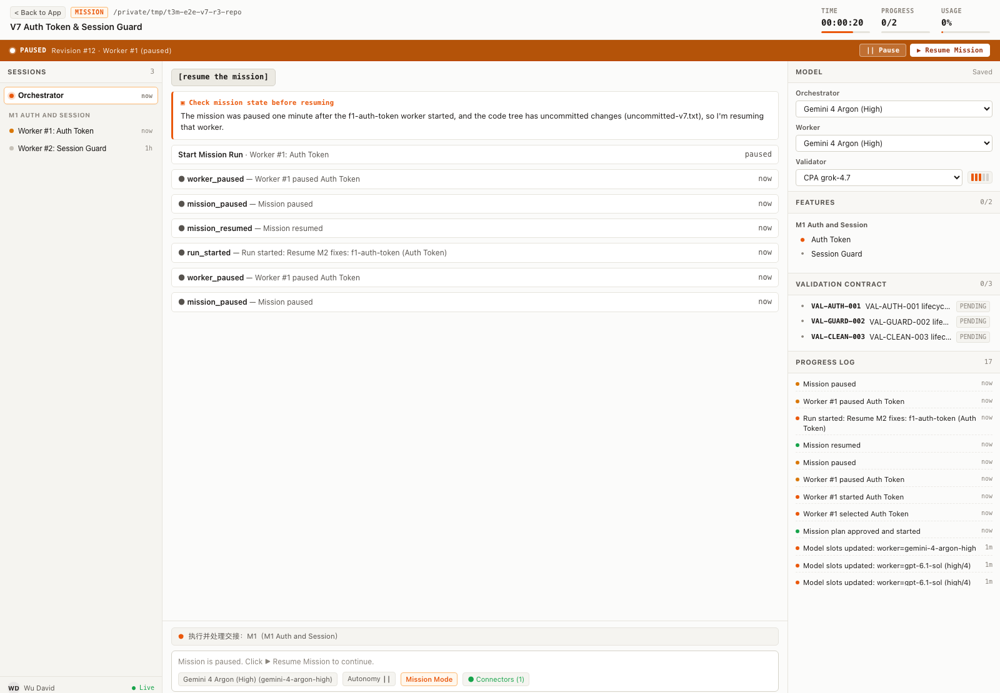
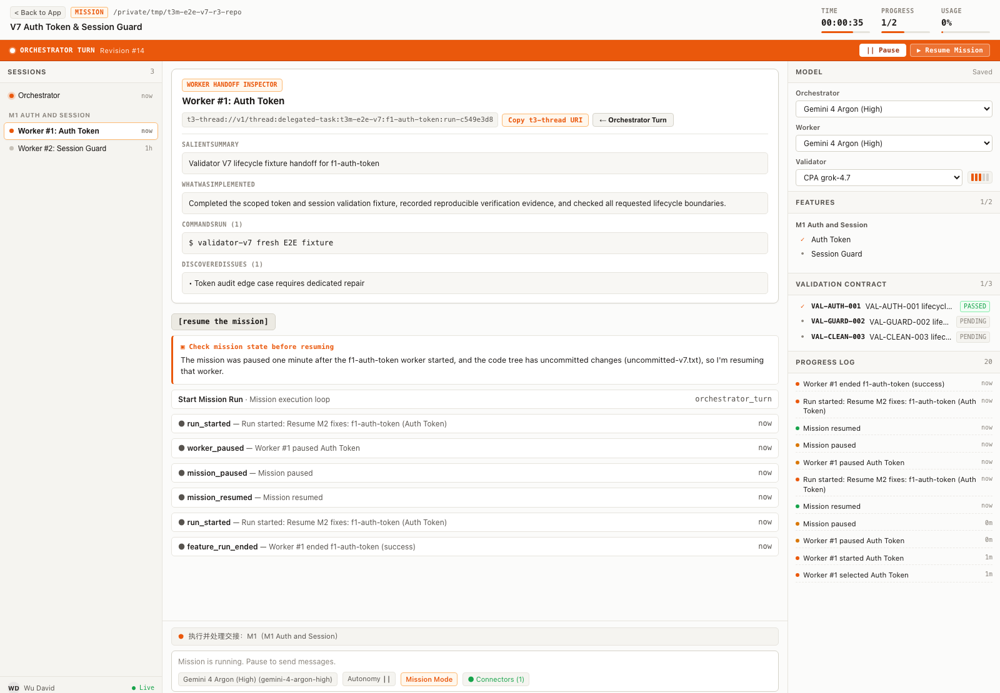
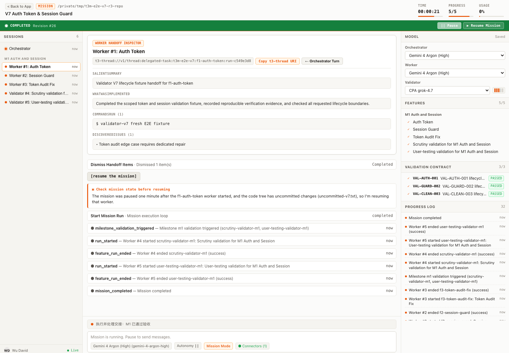
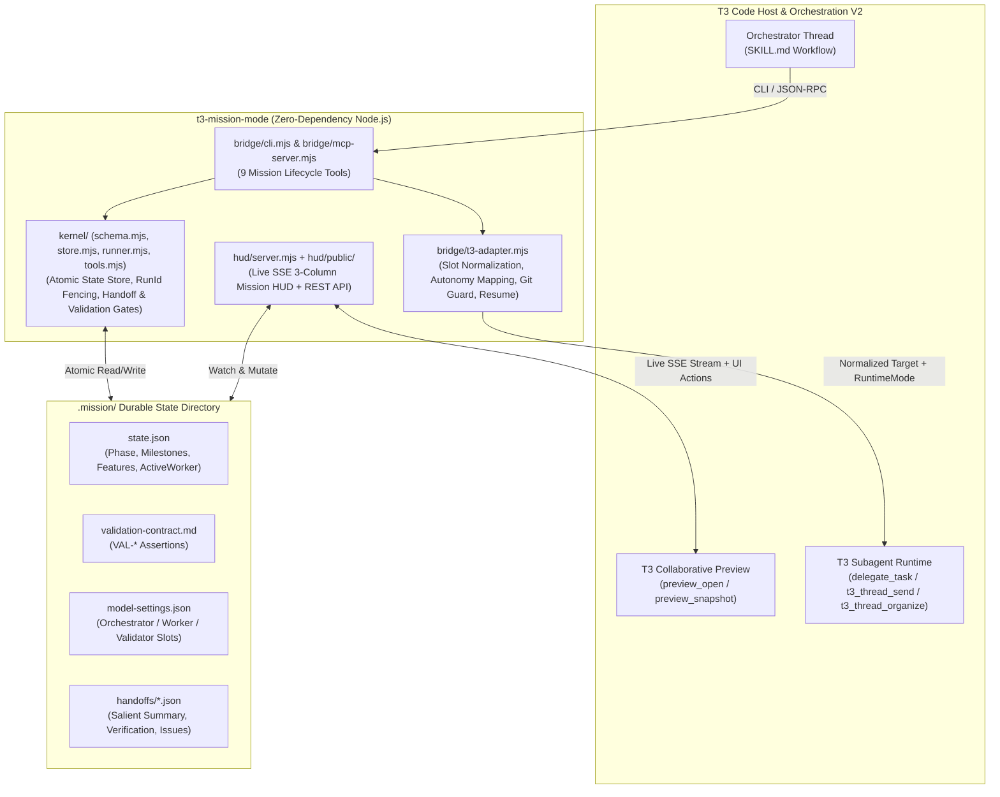

# T3 Mission Mode (`t3-mission-mode`)

<p align="center">
  
  
  
  
</p>

> **Durable Multi-Milestone Mission Mode for T3 Code** — Transform any T3 Code thread into a persistent, verifiable, multi-milestone software engineering orchestrator with **3-Role Heterogeneous Model Slots** (`Orchestrator` / `Worker` / `Validator`), a **Live SSE 3-Column Mission HUD**, **Git-Guarded Lossless Pause & Resume**, and **Cross-Provider Autonomy Mapping**.
>
> **面向 T3 Code 的持久化多里程碑 Mission 编排引擎** —— 将任意 T3 Code 会话升级为具备磁盘状态持久化（`.mission/`）、三角色异构模型槽位（`Orchestrator` / `Worker` / `Validator`）、实时三栏 SSE Mission HUD 面板、Git 工作树安全门禁无损暂停/恢复，以及跨 Provider 权限与推理强度自动映射的工程级 Mission 系统。

---

## ✨ Core Highlights / 核心特性

1. **3-Role Heterogeneous Model Slots (`Orchestrator` / `Worker` / `Validator`) / 三角色异构模型槽位**
   - Assign specialized providers and models to each role in `.mission/model-settings.json` or live in the HUD:
     - **Orchestrator (`orchestrator`)**: Plans milestones, features, and `VAL-*` validation contracts; manages handoff gates and checkpoints.
     - **Worker (`worker`)**: Executes scoped feature implementations inside isolated Git worktrees (`isolation: "worktree"`, `role: "implementation"`).
     - **Validator (`validator`)**: Runs independent **Scrutiny** (`role: "review"`) and **User-Testing** (`role: "test"`) verification at the end of every milestone.
   - 支持为规划编排（Orchestrator）、隔离开发（Worker）与独立验收（Validator）分别指定不同供应商与模型，实现性价比与工程质量的最优组合。

2. **Live SSE 3-Column Mission HUD / 实时 SSE 三栏可视化监控面板**
   - Zero-dependency HTTP + Server-Sent Events (`text/event-stream`) server rendered directly in T3 Code's right-side collaborative preview panel.
   - Displays **Milestones & Features** (left), **Active Worker & Handoff Inspector** (center), and **Validation Contract (`VAL-*`) + Model Slots** (right) with real-time state updates.

3. **Capability-Aware Effort Bar Gating / 能力感知的推理档位自适应显隐**
   - Models with configurable effort tiers (e.g., `GPT-5.4`, `Claude Opus 4.7`) display an interactive 5-bar effort selector (`1..5` -> `minimal | low | medium | high | max`).
   - Fixed-tier models (e.g., `Gemini 4 Argon (High)`, `Claude Opus 5.5 (High)`) where `supportsEffort === false` automatically hide the effort bar selector (`hidden === true`) to prevent invalid parameter injection.

4. **Cross-Provider Autonomy & Runtime Mode Mapping with Fail-Closed Ceiling / 跨 Provider 权限映射与父会话安全上限**
   - Normalizes T3 approval/runtime modes across **Factory Droid** (`acpRegistry_factory_droid`), **Devin** (`acpRegistry_devin`), **Cursor** (`acpRegistry_cursor`), **Codex** (`codex`), **Antigravity** (`antigravity`), **Grok / CPA** (`grok` / `cpa`), and **Pi** (`pi`).
   - Enforces a **fail-closed parent ceiling** (`resolveEffectiveRuntimeMode`): child tasks can never escalate beyond the parent thread's runtime permission ceiling, and unsupported modes automatically fall back to the highest safe mode supported by both parent and target provider.

5. **Git-Guarded Lossless Pause & Resume / Git 安全门禁与无损恢复**
   - Closing T3 Code or pausing mid-feature preserves full state in `.mission/state.json`.
   - Before resuming (`CheckMissionStateBeforeResuming`), the engine inspects `git status --porcelain` in the target worktree (`checkGitTreeBeforeResume`). If clean, `StartMissionRun` prioritizes `t3_thread_send` on the original `activeWorker.childThreadId` to wake the exact worker thread in place without spawning duplicate tasks. If merge conflicts exist, it blocks execution and surfaces a clear diagnostic.

6. **Handoff Gate & Dynamic Feature Expansion / 交接门禁与动态任务扩展**
   - Every finished Worker submits a structured handoff (`salientSummary`, `whatWasImplemented`, `whatWasLeftUndone`, `verification`, `discoveredIssues`) fenced by `(featureId, runId)`.
   - Unfinished work or non-trivial discovered issues trigger a mandatory Handoff Gate: the Orchestrator must either expand the plan (`UpdateMissionFeatures`) or record an explicit justification (`>= 20` characters via `DismissHandoffItems`) before advancing.

7. **Two-Stage Milestone Validation (`scrutiny` + `user-testing`) / 双阶段里程碑强制验收**
   - Every milestone automatically injects two independent validator gates: **Scrutiny Validation** (code quality, architectural boundaries, unit tests) and **User-Testing Validation** (end-to-end verification of `VAL-*` assertions). Completed child threads are automatically settled via `t3_thread_organize({ action: "settle" })`.

---

## ⚡ 30-Second Quickstart / 30 秒快速开始

### 1. Install the Skill / 安装技能

```bash
git clone https://github.com/aa2246740/t3-mission-mode.git
cd t3-mission-mode
./install.sh
```

`install.sh` installs the canonical package into `~/.agents/skills/t3-mission-mode`, creates `~/.agent/skills -> ~/.agents/skills` if needed, and links the skill into all detected agent skill directories (`~/.codex/skills`, `~/.claude/skills`, `~/.gemini/antigravity-cli/skills`, `~/.gemini/skills`, `~/.factory/skills`, `~/.pi/agent/skills`, `~/.cursor/skills`, etc.).

### 2. Trigger in T3 Code / 在 T3 Code 中启动与恢复

- **Start a new Mission / 开启新 Mission**:
  ```text
  /mission Build a full-stack analytics dashboard with authentication, CSV export, and E2E tests
  ```
  *(or simply say `开启 mission: <需求描述>`)*

- **Resume a paused Mission / 无损恢复已暂停的 Mission**:
  ```text
  [resume the mission]
  ```
  *(or say `继续` / `恢复 mission`)*

---

## 🖥️ Visual 6-Step Onboarding Walkthrough / 可视化全流程指南

### Step 1: Zero-Mission Onboarding Guide / 初始引导态

When the Mission HUD starts on a repository without an active `.mission/state.json`, it renders a bilingual 4-step Onboarding Guide explaining how `/mission` works:

```bash
node t3-mission/hud/server.mjs --mission-dir .mission
```



---

### Step 2: Plan Proposal & Mandatory Approval Gate / 计划提案与强制审批门禁

After read-only `Explorer` subagents map the repository, the Orchestrator calls `ProposeMission` to write `.mission/state.json`, `.mission/validation-contract.md`, and `.mission/model-settings.json`.
**Hard Guardrail**: No implementation `Worker` can be dispatched until you review the Milestones, Features, and `VAL-*` assertions in the HUD and click **Approve Plan**.

```bash
node t3-mission/bridge/cli.mjs ProposeMission --mission-dir .mission --json '<plan-payload>'
```



---

### Step 3: 3-Role Model Slots & Capability-Aware Effort Gating / 三角色模型槽位与推理档位门禁

Configure different providers and models for **Orchestrator**, **Worker**, and **Validator** directly in the HUD header.
- Models with `supportsEffort: true` (such as `GPT-5.4` or `Claude Opus 4.7`) display the 5-bar effort selector (`1..5`).
- Fixed-tier models with `supportsEffort: false` (such as `Gemini 4 Argon (High)`) automatically hide the effort bar selector (`hidden: true`).



---

### Step 4: Serial Worker Execution in Isolated Worktrees / 隔离工作树串行开发

Once approved (`ApproveMissionPlan` + `StartMissionRun`), the Orchestrator dispatches the active feature's `Worker` via `delegate_task` with `isolation: "worktree"` and normalized provider options (`normalizeTargetFromSlot`). The HUD streams live worker progress, child thread ID, and isolated worktree path:

```bash
node t3-mission/bridge/cli.mjs ApproveMissionPlan --mission-dir .mission
node t3-mission/bridge/cli.mjs StartMissionRun --mission-dir .mission
```



---

### Step 5: Git-Guarded Lossless Pause & Resume / Git 安全门禁与暂停恢复

You can pause the Mission at any time from the HUD (`Pause`) or close T3 Code. When resuming via `[resume the mission]`, `CheckMissionStateBeforeResuming` inspects `git status --porcelain` on the worker's worktree (`checkGitTreeBeforeResume`). If clean, `StartMissionRun` calls `t3_thread_send` on the existing `childThreadId` to wake the original worker thread losslessly:

```bash
node t3-mission/bridge/cli.mjs CheckMissionStateBeforeResuming --mission-dir .mission
node t3-mission/bridge/cli.mjs StartMissionRun --mission-dir .mission
```



---

### Step 6: Handoff Inspector Gate & Milestone Completion / 交接审查门禁与双阶段里程碑完结

When a Worker finishes (`EndFeatureRun`), its structured handoff is inspected in the HUD. Any `discoveredIssues` or `whatWasLeftUndone` items must be converted into follow-up features (`UpdateMissionFeatures`) or explicitly justified (`DismissHandoffItems`) before the Milestone runs its **Scrutiny** and **User-Testing** Validators:

```bash
node t3-mission/bridge/cli.mjs EndFeatureRun --mission-dir .mission --json '<handoff-payload>'
```



Once all features and both Milestone Validators (`scrutiny` + `user-testing`) pass and all `VAL-*` assertions are verified, the Mission transitions to `completed` and settles completed child threads:



---

## 🧭 Multi-Provider Autonomy & Effort Mapping Matrix / 跨 Provider 权限与推理强度映射矩阵

`normalizeTargetFromSlot(slotConfig)` and `mapApprovalModeToProviderAutonomy(providerInstanceId, slotConfig)` automatically translate T3 Mission Mode settings (`effort: 1..5`, `approvalMode`, `parentRuntimeMode`) into each provider's native schema:

| Provider (`providerInstanceId`) | Effort Mapping (`1..5` -> Native Option) | Default Mission Autonomy | Approval / Runtime Mode Mapping (`plan` / `approval-required` / `auto-accept-edits` / `auto` / `full-access`) |
| :--- | :--- | :--- | :--- |
| **Codex** (`codex`) | `options.reasoningEffort`: `"minimal" \| "low" \| "medium" \| "high" \| "xhigh" \| "max"` | `full-access` (clamped by parent ceiling) | Native T3 `runtimeMode` (`approval-required`, `auto-accept-edits`, `auto`, `full-access`) |
| **Antigravity** (`antigravity`) | Direct model tier ID (e.g. `gemini-4-argon-high`, `claude-opus-5-5-high`); effort bars auto-hidden when `supportsEffort: false` | `full-access` (clamped by parent ceiling) | Native T3 `runtimeMode` with fail-closed parent ceiling |
| **Factory Droid** (`acpRegistry_factory_droid`) | `options.reasoning_effort`: `"minimal" \| "low" \| "medium" \| "high" \| "max"` | `options.autonomy_level: "auto-high"` (prevents worker stalls) | `plan` <-> `"spec"`<br>`approval-required` <-> `"normal"`<br>`auto-accept-edits` <-> `"auto-low"`<br>`auto` <-> `"auto-high"` (`"auto-medium"` preserved when explicit)<br>`full-access` <-> `"auto-high"` |
| **Devin** (`acpRegistry_devin`) | `options.thought_level`: `1..3` -> `"medium"`, `4` -> `"high"`, `5` -> `"max"` | `options.mode: "bypass"` (prevents shell command stalls) | `plan` / `approval-required` -> `"ask"`<br>`auto-accept-edits` -> `"accept-edits"`<br>`auto` / `full-access` -> `"bypass"` |
| **Cursor** (`acpRegistry_cursor`) | `options.reasoning_effort` (`"low".."xhigh"`) + `options.effort` (`"low".."max"`) | `options.mode: "agent"` | `plan` -> `"plan"`<br>`approval-required` -> `"ask"`<br>`auto-accept-edits` / `auto` / `full-access` -> `"agent"` |
| **Grok / CPA** (`grok` / `cpa`) | `options.reasoningEffort`: `"low" \| "medium" \| "high" \| "xhigh"` (clamps `minimal`->`low`, `max`->`xhigh`) | `full-access` (clamped by parent ceiling) | Native T3 `runtimeMode` with fail-closed parent ceiling |
| **Pi** (`pi`) | `options.thinking`: `"minimal" \| "low" \| "medium" \| "high" \| "xhigh" \| "max"` | Highest supported mode `<= parentRuntimeMode` | Filtered against `["approval-required", "auto-accept-edits", "full-access"]` with fail-closed parent ceiling |

---

## 🏗️ Architecture Diagram / 系统架构图



---

## 🛠️ CLI & Testing Reference / 命令行与测试参考

### Run the Unit Test Suite (`47/47 PASS`) / 运行单元测试

`t3-mission-mode` uses Node.js's built-in test runner (`node:test`) with zero external dependencies:

```bash
npm test
# or directly:
node --test t3-mission/test/bridge.test.mjs t3-mission/test/hud.test.mjs t3-mission/test/kernel.test.mjs
```

### Start the Mission HUD Server / 启动 HUD 服务

```bash
npm run hud -- --mission-dir .mission
# or with an explicit port:
node t3-mission/hud/server.mjs --mission-dir .mission --port 43110
```

### Mission Lifecycle CLI Commands / 核心生命周期 CLI 命令

```bash
# 1. Propose a Mission Plan (enters awaiting_approval)
node t3-mission/bridge/cli.mjs ProposeMission --mission-dir .mission --json '<plan-json>'

# 2. Approve the proposed plan
node t3-mission/bridge/cli.mjs ApproveMissionPlan --mission-dir .mission

# 3. Pre-check Mission state & Git working tree before resuming
node t3-mission/bridge/cli.mjs CheckMissionStateBeforeResuming --mission-dir .mission

# 4. Start or resume the active feature/validator run
node t3-mission/bridge/cli.mjs StartMissionRun --mission-dir .mission

# 5. Record a finished Worker or Validator handoff (fenced by featureId + runId)
node t3-mission/bridge/cli.mjs EndFeatureRun --mission-dir .mission --json '<handoff-json>'

# 6. Dynamically add/update features or dismiss non-blocking handoff items
node t3-mission/bridge/cli.mjs UpdateMissionFeatures --mission-dir .mission --json '<features-json>'
node t3-mission/bridge/cli.mjs DismissHandoffItems --mission-dir .mission --json '<dismiss-json>'
```

---

## 📄 License

Released under the [MIT License](./LICENSE).
